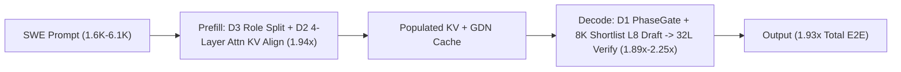
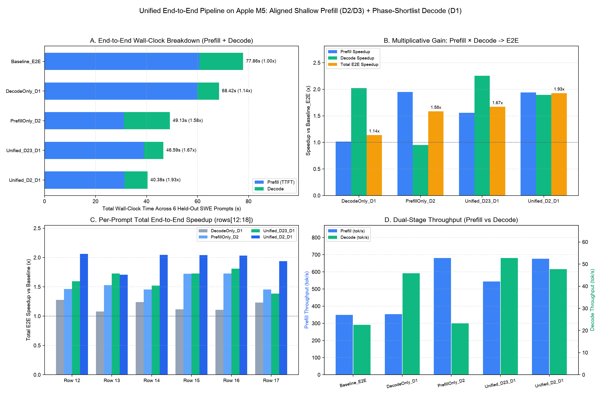
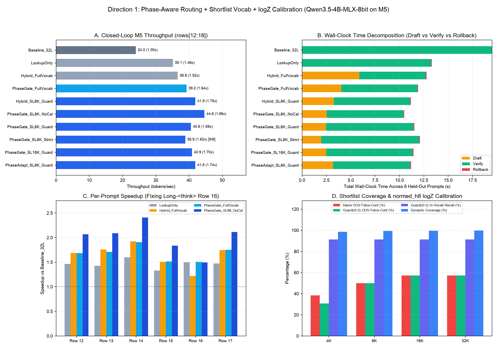
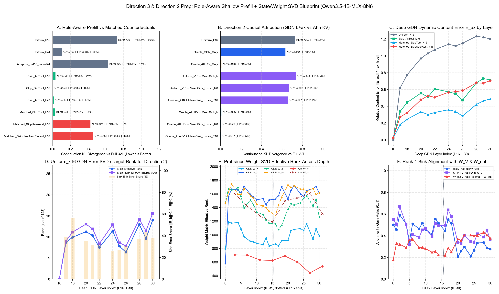
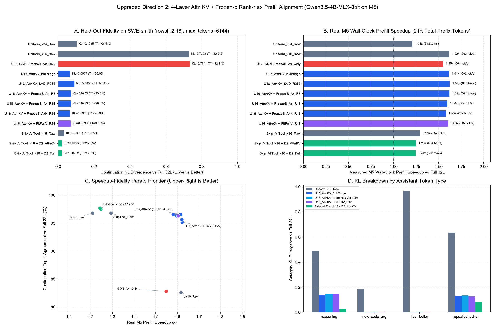

# SEED Agent Lab

[English](README.md) | [简体中文](README_ZH.md) | [Interactive Research Blog (GitHub Pages)](https://wm2541-cyber.github.io/Seed_agent_lab/)

**Hybrid Prefill Alignment & Speculative Decoding for Coding Agents on Apple Silicon (`Qwen3.5-4B-MLX-8bit`)**

> **TL;DR**
> Unifying **4-Layer Deep Attn-KV Prefill Alignment (D2)**, **Role-Aware Tool-Noise Shallow Prefill (D3)**, and **Phase-Aware + 8K Shortlist Self-Speculative Decoding (D1)** on Apple Silicon M5 (16 GB) across multi-turn `SWE-smith` trajectories (`1.6K–6.1K` prompts):
> - **End-to-End (Prefill + Decode)**: **`1.93x`** total speedup (`77.86s -> 40.38s`, `4/6` prompts `> 2.0x`); high-fidelity role-aware mode **`1.67x`**.
> - **Prefill (TTFT)**: **`1.94x`** (`349.1 -> 676.8 tok/s`). Aligning only **4 deep Full-Attention KV layers (`L19,23,27,31`)** via 14s closed-form Ridge cuts `Uniform_k16` KL by **`10.9x`** (`0.7292 -> 0.0667`, `Top-5 = 100%`).
> - **Decode (Exact Greedy)**: **`1.86x–2.25x`** (`22.55 -> 45.88–52.78 tok/s`, `Tau = 2.39–3.70`).
> - **Zero-Training Role-Aware Finding**: At matched compute (`13.2%`), shallow-prefilling `USER/ASSISTANT` is **`13.9x–14.8x` worse in KL** than shallow-prefilling `<tool_response>` logs; skipping older tool turns (`Skip_OldTool_k16`) achieves **`KL = 0.0031, Top-1 = 99.8%`**.

---

## Pipeline Overview



---

## 1. Unified End-to-End M5 Benchmark (`rows[12:18]`, `1.6K–6.1K` Prompts)

| Mode | Prefill (s) | Decode (s) | Total (s) | Prefill Sp | Decode Sp | **E2E Speedup** | Prefill tok/s | Decode tok/s | Tau |
| :--- | :---: | :---: | :---: | :---: | :---: | :---: | :---: | :---: | :---: |
| `Baseline_E2E` (32L + 32L) | 60.79 | 17.07 | 77.86 | 1.00x | 1.00x | **1.00x** | 349.1 | 22.55 | 1.00 |
| `DecodeOnly_D1` (32L + D1) | 59.98 | 8.43 | 68.42 | 1.01x | 2.02x | **1.14x** | 353.8 | 45.88 | 3.39 |
| `PrefillOnly_D2` (D2 + 32L) | 31.17 | 17.96 | 49.13 | 1.95x | 0.95x | **1.58x** | 681.0 | 23.22 | 1.00 |
| **`Unified_D23_D1`** (Role-Aware + D2 + D1) | 39.01 | 7.58 | 46.59 | 1.56x | **2.25x** | **1.67x** | 544.1 | **52.78** | **3.70** |
| **`Unified_D2_D1`** (D2 `U16_AttnKV` + D1) | **31.36** | 9.02 | **40.38** | **1.94x** | 1.89x | **1.93x** | **676.8** | 47.68 | 3.16 |



---

## 2. Module Evidence & Figures

### Direction 1 — Phase-Aware Routing + 8K Quantized Shortlist (`1.86x` Lossless Decode)
Skipping Layer-8 neural drafting inside `<think>` fixes long-reasoning regression (`Row 16: 1.22x -> 1.49x`), while bit-exact row-slicing `QuantizedEmbedding` to `Top-8K ∪ prompt` (`99.43%` coverage, `max_abs_diff = 0.0`, `LM_head` `11.5x` faster) pushes Decode from `24.00 -> 44.63 tok/s` (**`1.86x`**, `6/6` exact match, peaking at `2.41x`).



### Direction 3 — Role-Aware Shallow Prefill & 32-Layer SVD Probes
- **Tool-Noise Dilution**: At identical skipped compute (`13.2%`, `899` tokens), `Matched_SkipTool_k16` (`KL = 0.0308`) beats `Matched_SkipUserAsst_k16` (`KL = 0.4270–0.4546`) by **`13.9x–14.8x`**. `Skip_OldTool_k16` hits **`KL = 0.0031, Top-1 = 99.8%`** with zero training.
- **Causal Attribution & Weight SVD**: **`98.8%`** of `Uniform_k16`'s KL loss (`0.7292 -> 0.0088`) comes from the **4 deep Full-Attention KV layers (`L19,23,27,31`)**, which also have the lowest weight rank (`W_K effRank = 395`, `W_V = 569`). Deep GDN state error `E_ax` has effective rank `9.2`.



### Direction 2 — 4-Layer Deep Attn-KV Closed-Form Alignment (`1.61x` Prefill, `10.9x` KL Drop)
Solved in **14.19s** via shared-Gram Cholesky on 48 training traces (zero SGD), `U16_AttnKV_FullRidge` cuts `Uniform_k16` KL **`10.9x`** (`0.7292 -> 0.0667`, `Top-1 = 96.6%`, `Top-5 = 100%`) at **`1.61x` M5 Prefill speedup**—beating `Uniform_k24` in both speed (`1.61x vs 1.21x`) and KL (`0.0667 vs 0.1035`). Pairing with `Skip_AllTool_k16` reaches **`KL = 0.0196` (`Top-1 = 97.7%`)**.



---

## 3. Reading Order, Layout & From-Scratch Reproduction

> **Recommended Reading Order**: Start with [`unified_e2e_pipeline/pipeline.py`](unified_e2e_pipeline/pipeline.py) to see the full Prefill + Decode system, then dive into `direction1_phase_shortlist/`, `direction2_hybrid_prefill_align/`, or `direction3_role_prefill_svd/` for individual algorithms and ablations.

```text
seed_agent_lab/
├── unified_e2e_pipeline/           # Unified Prefill (D2/D3) + Decode (D1) pipeline & E2E benchmark
├── direction1_phase_shortlist/     # D1: Phase-Aware routing + 8K quantized shortlist + logZ calibrator
├── direction2_hybrid_prefill_align/# D2: 4-Layer Attn KV + 11-Layer GDN FreezeB/Ax aligners
├── direction3_role_prefill_svd/    # D3: Role-Aware Shallow Prefill + 32-layer Weight/State SVD probes
├── seed_agent_lab/ & tests/        # Core closed-loop engine, SEED operators, and SWE loader
└── figures/                        # Summary charts
```

> **Note**: Binary `.npz` checkpoints are excluded from Git (see `.gitignore`) and rebuilt locally in steps 2–3 below. `MLX_METAL_GPU_ARCH=g16g` is only needed on macOS 26 / M5 if Metal NAX JIT errors occur.

```bash
# 0. Install environment & run pure/model tests (52 tests)
uv sync
MLX_METAL_GPU_ARCH=g16g uv run pytest -v

# 1. Download Qwen3.5-4B-MLX-8bit to ~/Models/Qwen3.5-4B-MLX-8bit
huggingface-cli download mlx-community/Qwen3.5-4B-MLX-8bit --local-dir ~/Models/Qwen3.5-4B-MLX-8bit

# 2. Fit Layer-8 Assistant-only Ridge rotation W_8 (48 train traces)
MLX_METAL_GPU_ARCH=g16g uv run python -m seed_agent_lab.save_ridge_checkpoint

# 3. Build D1 8K shortlist/logZ artifacts & D2 4-Layer Attn KV aligner (48 train traces)
MLX_METAL_GPU_ARCH=g16g uv run python -m direction1_phase_shortlist.build_artifacts
MLX_METAL_GPU_ARCH=g16g uv run python -m direction2_hybrid_prefill_align.train_aligners --anchor-layer 16 --max-tokens 2560 --ridge-lambda 200.0 --gdn-rank 16

# 4. Run Unified End-to-End M5 Benchmark (Prefill + Decode)
MLX_METAL_GPU_ARCH=g16g uv run python -m unified_e2e_pipeline.benchmark_e2e --max-prompt-tokens 6144 --max-new-tokens 160
```
