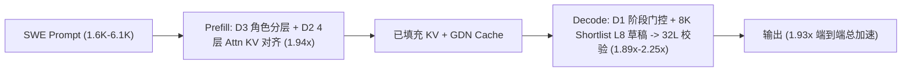
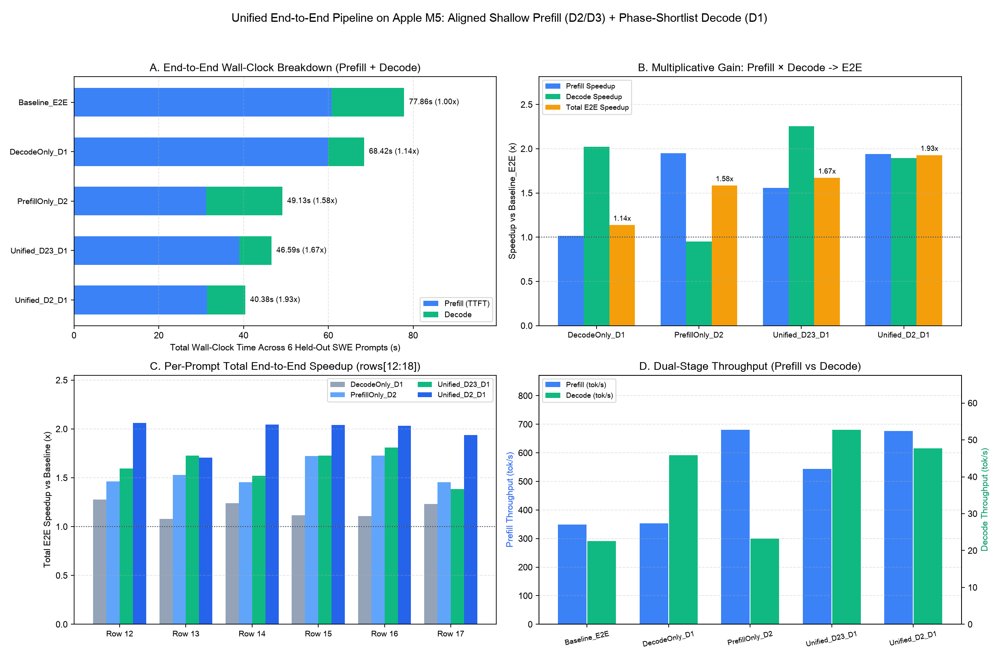
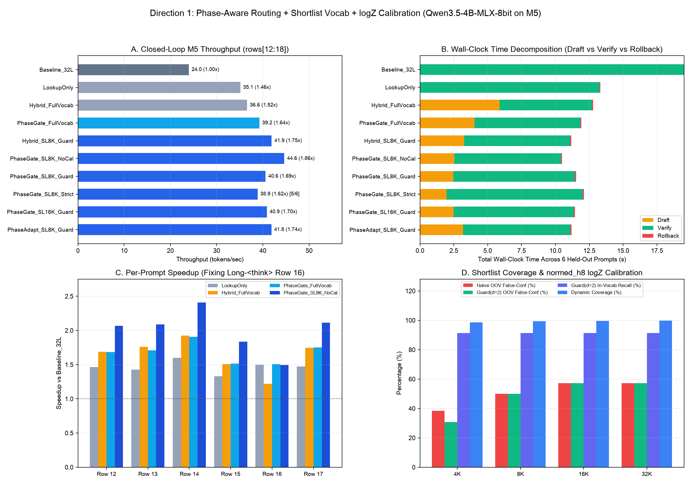
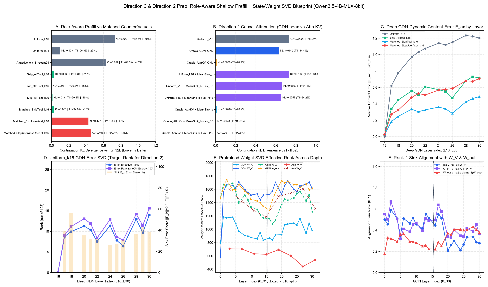
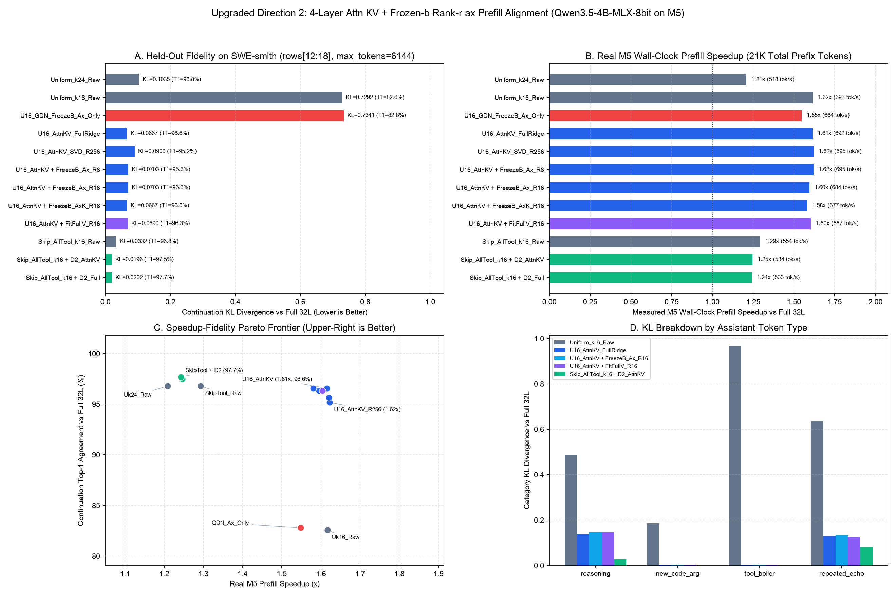

# SEED Agent Lab

[English](README.md) | [简体中文](README_ZH.md) | [交互式技术博客 (GitHub Pages)](https://wm2541-cyber.github.io/Seed_agent_lab/)

**面向 Apple Silicon 的 Coding Agent 混合 Prefill 对齐与自投机解码（`Qwen3.5-4B-MLX-8bit`）**

> **核心结论**
> 在 Apple Silicon M5 (16 GB) 上针对多轮长上下文 SWE Coding Agent 轨迹（`Qwen3.5-4B-MLX-8bit` + `SWE-smith`，`1.6K–6.1K` tokens），将 **4 层深层 Attn-KV Prefill 对齐（方向二）**、**Role-Aware 工具噪音浅层 Prefill（方向三）** 与 **阶段感知 + 8K Shortlist 自投机解码（方向一）** 拼成统一端到端推理管线：
> - **端到端总加速（Prefill + Decode）**：**`1.93x`**（`77.86s -> 40.38s`，`4/6` 样本突破 **`2.0x`**）；高保真 Role-Aware 联合版 **`1.67x`**。
> - **Prefill（TTFT）**：**`1.94x`**（`349.1 -> 676.8 tok/s`）。仅用 14 秒闭式 Ridge 对齐 **4 层深层 Full-Attention KV（`L19,23,27,31`）**，即在零额外延迟下将 `Uniform_k16` KL 压降 **`10.9x`**（`0.7292 -> 0.0667`，`Top-5 = 100%`）。
> - **Decode（贪婪等价）**：**`1.86x–2.25x`**（`22.55 -> 45.88–52.78 tok/s`，`Tau = 2.39–3.70`）。
> - **零训练 Role-Aware 实证**：同等跳过算力（`13.2%`）下，跳过 `USER/ASSISTANT` 的 KL 比跳过 `<tool_response>` **差 `13.9x–14.8x`**；仅跳过历史旧工具输出（`Skip_OldTool_k16`）零训练即达 **`KL = 0.0031, Top-1 = 99.8%`**。

---

## 管线总览



---

## 1. 统一端到端 M5 实测基准（`rows[12:18]`，`1.6K–6.1K` Prompts）

| 模式 | Prefill (s) | Decode (s) | 总耗时 (s) | Prefill 加速 | Decode 加速 | **端到端总加速** | Prefill tok/s | Decode tok/s | Tau |
| :--- | :---: | :---: | :---: | :---: | :---: | :---: | :---: | :---: | :---: |
| `Baseline_E2E` (32L + 32L) | 60.79 | 17.07 | 77.86 | 1.00x | 1.00x | **1.00x** | 349.1 | 22.55 | 1.00 |
| `DecodeOnly_D1` (32L + D1) | 59.98 | 8.43 | 68.42 | 1.01x | 2.02x | **1.14x** | 353.8 | 45.88 | 3.39 |
| `PrefillOnly_D2` (D2 + 32L) | 31.17 | 17.96 | 49.13 | 1.95x | 0.95x | **1.58x** | 681.0 | 23.22 | 1.00 |
| **`Unified_D23_D1`** (Role-Aware + D2 + D1) | 39.01 | 7.58 | 46.59 | 1.56x | **2.25x** | **1.67x** | 544.1 | **52.78** | **3.70** |
| **`Unified_D2_D1`** (D2 `U16_AttnKV` + D1) | **31.36** | 9.02 | **40.38** | **1.94x** | 1.89x | **1.93x** | **676.8** | 47.68 | 3.16 |



---

## 2. 三大模块实证图表

### 方向一 — 阶段感知路由 + 8K 量化子词表（`1.86x` 无损 Decode）
在 `<think>` 内关闭 L8 神经草稿（修复长思考样本 `Row 16: 1.22x -> 1.49x`），在 `<tool_call>` 内启用逐位无损的 `Top-8K ∪ prompt` 量化子词表（`99.43%` 覆盖率，`max_abs_diff = 0.0`，`LM_head` 提速 `11.5x`），整体吞吐从 `24.00 -> 44.63 tok/s`（**`1.86x`**，`6/6` 贪婪完全一致，单条最高 `2.41x`）。



### 方向三 — Role-Aware Shallow Prefill 与 32 层 SVD 探针
- **工具噪音信息稀释**：同算力（`13.2%`、`899` tokens）下，`Matched_SkipTool_k16`（`KL = 0.0308`）领先 `Matched_SkipUserAsst_k16`（`KL = 0.4270–0.4546`）达 **`13.9x–14.8x`**；`Skip_OldTool_k16` 零训练即实现 **`KL = 0.0031, Top-1 = 99.8%`**。
- **因果归因与权重 SVD**：`Uniform_k16` 高达 **`98.8%`** 的 KL 损失（`0.7292 -> 0.0088`）集中在 **4 层深层 Full-Attention KV（`L19,23,27,31`）**，且这 4 层恰为全模型权重有效秩最低的层（`W_K effRank = 395, W_V = 569`）；12 层 GDN 状态误差 `E_ax` 有效秩仅 `9.2`。



### 方向二 — 4 层深层 Attn-KV 闭式对齐（`1.61x` Prefill，`10.9x` KL 压降）
48 条训练轨迹经 **14.19s** 共享 Gram Cholesky 闭式求解（零 SGD），`U16_AttnKV_FullRidge` 在零额外延迟下将 `Uniform_k16` KL 压降 **`10.9x`**（`0.7292 -> 0.0667`，`Top-1 = 96.6%`，`Top-5 = 100%`），在速度（`1.61x vs 1.21x`）与精度（`0.0667 vs 0.1035`）上双杀 `Uniform_k24`；与 `Skip_AllTool_k16` 联合后达 **`KL = 0.0196`（`Top-1 = 97.7%`）**。



---

## 3. 推荐阅读顺序、目录与从零复现

> **推荐阅读顺序**：先读 [`unified_e2e_pipeline/pipeline.py`](unified_e2e_pipeline/pipeline.py) 看懂完整 Prefill + Decode 端到端闭环，再按需进入 `direction1_phase_shortlist/`、`direction2_hybrid_prefill_align/`、`direction3_role_prefill_svd/` 查看各模块原理与消融实验。

```text
seed_agent_lab/
├── unified_e2e_pipeline/           # 统一端到端管线 (Prefill D2/D3 + Decode D1) 与 E2E 基准
├── direction1_phase_shortlist/     # 方向一: 阶段感知路由 + 8K 量化子词表 + logZ 校准
├── direction2_hybrid_prefill_align/# 方向二: 4 层 Attn KV + 11 层 GDN 冻结 b/训 ax 对齐
├── direction3_role_prefill_svd/    # 方向三: Role-Aware Shallow Prefill + 32 层权重/状态 SVD 探针
├── seed_agent_lab/ & tests/        # 基础闭环引擎、SEED 分解算子与 SWE 数据加载
└── figures/                        # 汇总图表
```

> **说明**：本地 `.npz` 对齐权重未提交至 Git（详见 `.gitignore`），通过下方步骤 2–3 即可一键重建；`MLX_METAL_GPU_ARCH=g16g` 仅在 macOS 26 / M5 遇到 Metal NAX JIT 报错时需要。

```bash
# 0. 安装依赖并运行全部 52 项单元与集成测试
uv sync
MLX_METAL_GPU_ARCH=g16g uv run pytest -v

# 1. 下载模型至 ~/Models/Qwen3.5-4B-MLX-8bit
huggingface-cli download mlx-community/Qwen3.5-4B-MLX-8bit --local-dir ~/Models/Qwen3.5-4B-MLX-8bit

# 2. 拟合 Layer-8 Assistant-only 旋转矩阵 W_8（48 条训练轨迹）
MLX_METAL_GPU_ARCH=g16g uv run python -m seed_agent_lab.save_ridge_checkpoint

# 3. 构建方向一 8K 词表/logZ 校准器 与 方向二 4 层 Attn KV 对齐器（48 条训练轨迹）
MLX_METAL_GPU_ARCH=g16g uv run python -m direction1_phase_shortlist.build_artifacts
MLX_METAL_GPU_ARCH=g16g uv run python -m direction2_hybrid_prefill_align.train_aligners --anchor-layer 16 --max-tokens 2560 --ridge-lambda 200.0 --gdn-rank 16

# 4. 运行统一端到端 M5 基准测试（Prefill + Decode）
MLX_METAL_GPU_ARCH=g16g uv run python -m unified_e2e_pipeline.benchmark_e2e --max-prompt-tokens 6144 --max-new-tokens 160
```
