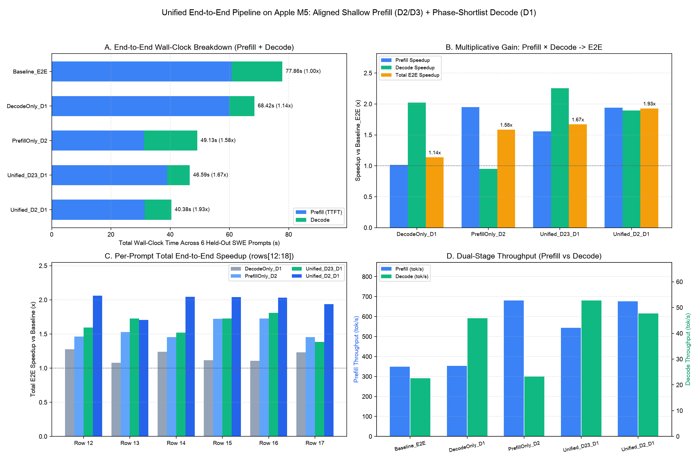

# Unified End-to-End Pipeline (`Prefill D2/D3 + Decode D1`)

> **结论 / TL;DR**: 将方向二/三对齐浅层 Prefill 与方向一阶段感知 8K Shortlist 自投机 Decode 拼成统一管线后，在 Apple M5 (`Qwen3.5-4B-MLX-8bit`, `rows[12:18]`, `1.6K–6.1K` prompts) 上实测端到端总提速 **`1.93x`**（`77.86s -> 40.38s`，`4/6` 样本 `> 2.0x`），高保真 Role-Aware 版 **`1.67x`**（Decode 达 **`52.78 tok/s / 2.25x`**）。



## Quickstart

```bash
# Unit & integration tests (2 tests)
MLX_METAL_GPU_ARCH=g16g .venv/bin/pytest unified_e2e_pipeline/tests -v

# Full 5-mode E2E M5 benchmark
MLX_METAL_GPU_ARCH=g16g .venv/bin/python -m unified_e2e_pipeline.benchmark_e2e --max-prompt-tokens 6144 --max-new-tokens 160
```
